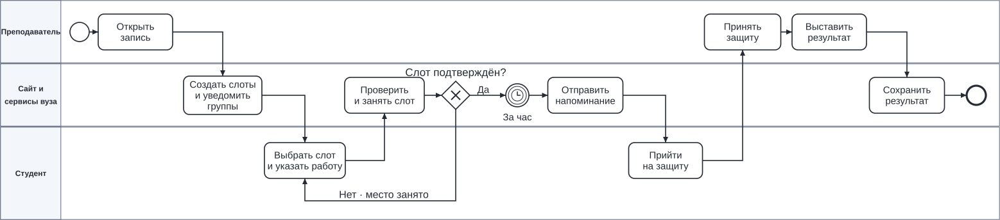

# Ресурсный анализ записи на защиту лабораторных работ

**Практическая работа № 1 по дисциплине «Проектирование информационных систем»**  
Тема: ресурсный анализ систем  
Вариант 2 — запись на консультации к преподавателям

Выполнили: Логданиди Кирилл, Газабагандов Шейхахмед  
Группа: K3341  
Преподаватель: Духанов Алексей Валентинович

**Назначение системы:** организовать запись студентов на защиту лабораторных работ во время консультационного приёма преподавателей.

**Основное правило:** один студент и одна работа на один слот длительностью 10 минут. Для разных работ можно занимать несколько слотов.

**Результат работы:** таблица преобразования ресурсов для одного очного посещения.

## 1 Характеристика процесса

### 1.1 Объект и границы

Для ресурсного анализа выбран целевой сценарий очной защиты одной лабораторной работы по предварительной записи. В этом сценарии запись ведётся через проектируемый сайт университета, концепция которого рассматривается в практической работе № 2. Процесс начинается, когда преподаватель открывает запись для выбранных групп, и заканчивается, когда результат защиты сохранён в истории посещений.

В процессе участвуют студент и преподаватель. Сайт, база записей, университетский вход и почта рассматриваются как один компонент системы. В выбранном сценарии студент записывается заранее и приходит в назначенную аудиторию.

### 1.2 Запись и проведение защиты

*Рисунок 1. Преподаватель открывает приём, студент занимает свободный слот и защищает работу. Сайт сохраняет результат.*

Если два студента выбирают одно время, сайт подтверждает запись одному из них. Второй видит сообщение о занятом месте и выбирает другой слот. За час до первого слота этого студента в данном приёме сайт напоминает студенту о его записях на этот приём. После защиты преподаватель выставляет результат вручную.

## 2 Ресурсный анализ

### 2.1 Виды ресурсов

В анализе использованы семь видов ресурсов из задания.

| Код | Вид ресурса | Пример в процессе |
|---|---|---|
| M | Материальный | Ноутбук для демонстрации работы, сервер и накопитель для сохранения записи |
| E | Энергетический | Энергия студента на дорогу, электроэнергия для работы ноутбука и сервера |
| C | Человеческий, компетентностный | Умение студента объяснить решение и умение преподавателя оценить ответ |
| Env | Пространственный | Аудитория и рабочее место, куда приходит студент |
| T | Временной | Время приёма преподавателя, время студента на дорогу и защиту |
| Adm | Административный | Право студента из выбранной группы занять слот, полномочие преподавателя выставить результат |
| I | Информационный | Состав групп, расписание, название работы, ответы студента и итоговая отметка |

### 2.2 Преобразование ресурсов по этапам

По строкам указаны роли и компонент системы, по столбцам — пять последовательных этапов. Прочерк означает, что на этом этапе у участника нет отдельного действия.

| Роль или компонент | 1. Открытие записи | 2. Бронирование | 3. Напоминание | 4. Очная защита | 5. Фиксация результата |
|---|---|---|---|---|---|
| Преподаватель | Выделяет время приёма (T), указывает номер аудитории и группы (I). Аудитория используется как место очной защиты (Env). По своим полномочиям открывает им запись (Adm). | После бронирования часть выделенного времени (T) закреплена за конкретным студентом и работой. | — | В аудитории (Env) использует время слота (T) и знание предмета (C), чтобы по демонстрации и ответам (I) определить, принята ли работа. | Использует право оценивания (Adm) и вводит принятое решение (I) — «Сдал» или «Не сдал». |
| Студент | Из уведомления (I) узнаёт время и место приёма. Принадлежность к выбранной группе даёт право на запись (Adm). | Сверяет расписание (I), использует право записи (Adm) и указывает работу. После подтверждения отводит в своём расписании 10 минут на защиту (T). | По времени и месту из напоминания (I) определяет, когда выйти и сколько времени оставить на дорогу (T). | Тратит время (T) и энергию (E) на дорогу в аудиторию (Env). На ноутбуке (M) показывает результат работы (I) и применяет знания (C), чтобы объяснить решение. | После сохранения студенту доступна отметка о результате защиты (I). |
| Сайт и сервисы вуза | По сведениям о выделенном интервале приёма (I) формирует список свободных слотов (I), представляющих доступное время преподавателя (T). По составу групп (I) открывает доступ (Adm) и рассылает уведомление на сайте и по почте. | Проверяет право студента (Adm) и состояние слота (I). Сохраняет связь «студент — время — работа» и меняет состояние места со свободного на занятое (I). | По сохранённому времени первого слота этого студента в данном приёме (I) вычисляет момент отправки за час до его начала. Из записей студента (I) формирует одно напоминание со всеми его слотами на этот приём. | — | Проверяет полномочие преподавателя (Adm). Использует накопитель сервера (M) и электроэнергию (E), чтобы сохранить отметку вместе с названием работы в истории посещений (I). |

### 2.3 Пример преобразования

Преподаватель открыл пустую очередь на приём с 14:00 до 16:00. Из 120 минут приёма сайт формирует **12 слотов по 10 минут**. Студент из выбранной группы занимает слот 14:10–14:20 для лабораторной № 3. После первой подтверждённой записи в очереди остаётся 11 свободных слотов.

В этом примере **T** — десять минут приёма, **Adm** — право студента занять место, **I** — запись о том, кто, когда и какую работу защищает. Бронирование распределяет время преподавателя. Само время расходуется во время защиты.

## 3 Выводы

При записи сайт связывает время преподавателя с конкретным студентом и работой. Право доступа определяется группой, а состояние слота в базе показывает, доступно ли это время остальным студентам.

Для очной защиты нужны аудитория, оборудование, энергия и время обоих участников. Студент применяет свои знания, чтобы показать и объяснить решение. Преподаватель оценивает ответы и выставляет отметку. В результате сведения о предстоящей защите дополняются результатом состоявшегося посещения.
